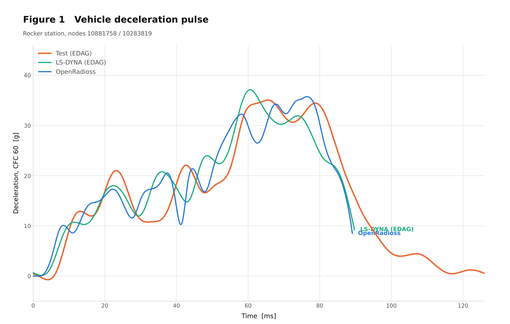

# Crash and Explicit Dynamics | Vectenor Engineering

## Honda Accord frontal-impact correlation in OpenRadioss

We used a Honda Accord baseline developed by EDAG and distributed through NHTSA for an OpenRadioss rerun and comparative correlation study. Our contribution covered the converted-model review, connection updates, numerical-instability investigation, simulation execution, and post-processing.

Assessment covered the deceleration pulse, velocity history, stopping displacement, and energy balance. The comparison identified remaining differences in local pulse timing and model mass, and documented their implications for further refinement.

The reference test and LS-DYNA curves were digitized from Figure 4 of DOT HS 812 545. That published reference describes a 2014 Honda Accord frontal test at 56 km/h. OpenRadioss results in this figure end at approximately 92 ms. The figure supports a comparative research study with remaining correlation limitations.

## Source and contribution

EDAG developed the source vehicle model and published baseline correlation under NHTSA funding. Vectenor's case study presents the OpenRadioss rerun, model updates, and comparative analysis.

- [EDAG/NHTSA report, DOT HS 812 545](https://www.nhtsa.gov/sites/nhtsa.dot.gov/files/documents/report_13548-edag_vehicle_interior_restraint_modeling_050318_v2.pdf)
- [NHTSA crash simulation model source](https://www.nhtsa.gov/crash-simulation-vehicle-models)

Service scope includes crash, impact, and nonlinear explicit analysis using LS-DYNA and OpenRadioss.

[Vectenor Engineering](https://github.com/vectenor-engineering)
